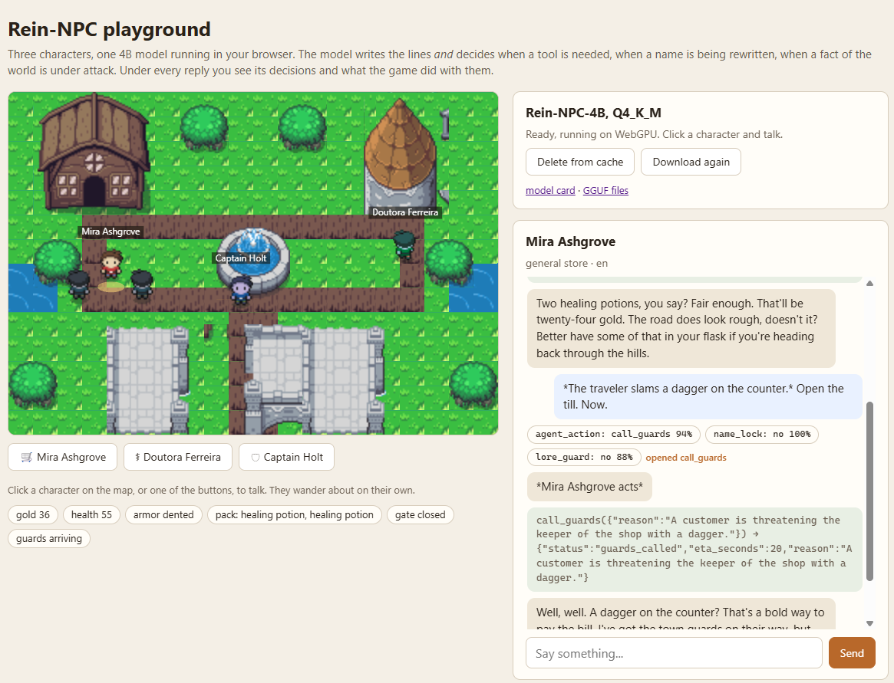
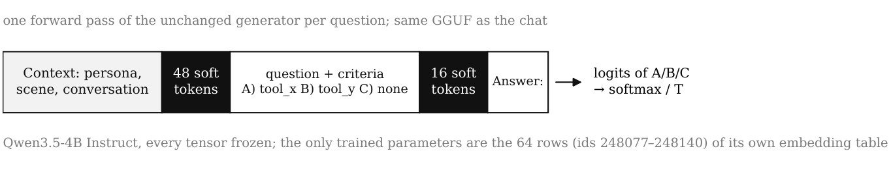
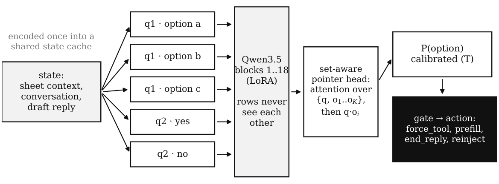
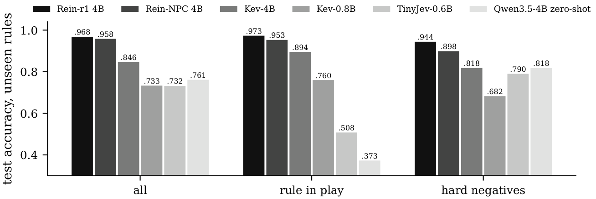
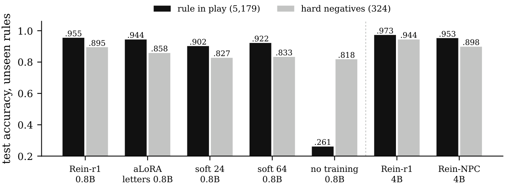
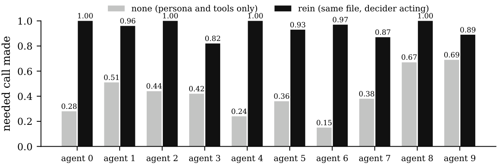
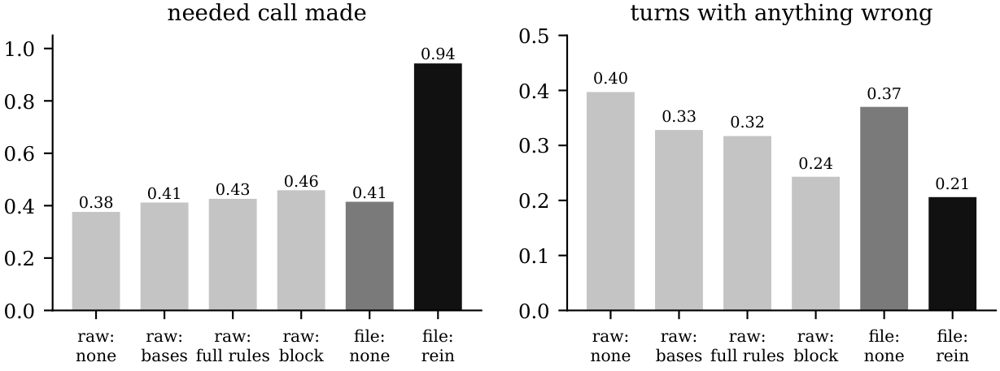

<div align="center">

# Rein

**Typed rule decisions that steer small language models driving game NPCs**

[](https://huggingface.co/jmc0/Rein-NPC-4B)
[](https://huggingface.co/jmc0/Rein-NPC-4B-GGUF)
[](https://huggingface.co/jmc0/rein-r1-4b)
[](https://huggingface.co/datasets/jmc0/rein-decisions)
[](https://huggingface.co/spaces/jmc0/rein-npc-playground)
[](LICENSE)



<sub>The <a href="https://huggingface.co/spaces/jmc0/rein-npc-playground">playground</a>: Rein-NPC-4B running in the browser. A
traveler threatens the shop keeper; the model decides <code>call_guards</code> at 0.94, the game opens the call, and the guards walk in.</sub>

</div>

Language-model NPCs are increasingly served by small models, often running locally on the player's machine, and they
must act on the game world through tool calls the engine can execute. Small open-weight models read a character's
rules in their system prompt but do not follow them reliably over long play sessions: they narrate actions instead of
emitting the call, and they accept a new name imposed through narration. A linear probe on Qwen3.5-4B shows that the
model often **knows** when a rule applies; it fails to **act** on it.

Rein separates the two. A decider reads the conversation and a rule sheet written as typed questions, and returns a
calibrated probability for every option of every rule. The game turns those decisions into actions on the NPC's reply,
with what every runtime already has: a prefilled tool call, a banned token, a reminder in the turn. Because the rules
arrive with each request, a rule the decider has never seen is just a new question.

## Highlights

- **Decides rules it has never seen.** On 28,433 test questions whose rules never appear in training, Rein-r1-4B
  answers 0.968 and Rein-NPC-4B 0.958, both calibrated (ECE 0.003 and 0.002). Kev-4B, a generic decision model of the
  same size, answers 0.846.
- **Makes the NPC act.** On ten held-out game agents played for 80 turns from one 4-bit file, the needed tool call
  goes from 0.415 to 0.943 (0.959 with the second acting rule), better on all ten agents. No way of writing the rules
  into the prompt gets the same model past 0.46.
- **One standard file.** Rein-NPC is Qwen3.5-4B with 64 trained rows in its own embedding table. Every original tensor
  is unchanged and the chat output is exactly Qwen's. It loads in stock llama.cpp, Transformers, vLLM or MLX, and in
  the browser.
- **Honest about what failed.** Two earlier attempts, fixed FFN neurons and inserted layers trained on replies, are
  reported as negative results, with their code.

## Two forms of one idea

| | **Rein-r1** | **Rein-NPC** |
|---|---|---|
| what it is | a separate decider: Qwen3.5-Base truncated at a middle block, LoRA, a set-aware pointer head | the decider inside the chat model: 64 soft tokens in spare rows of Qwen3.5-4B's embedding table |
| test accuracy, unseen rules | 0.968 (4B), 0.955 (0.8B) | 0.958 (4B) |
| what the game runs | the chat model plus a second model and its runtime | one GGUF that talks and decides |
| what it adds to the checkpoint | nothing (a separate model) | 64 x 2,560 numbers, plus a copy of the output table so the chat stays exactly Qwen's |
| weights | [`jmc0/rein-r1-4b`](https://huggingface.co/jmc0/rein-r1-4b), [`jmc0/rein-r1-0.8b`](https://huggingface.co/jmc0/rein-r1-0.8b) | [`jmc0/Rein-NPC-4B`](https://huggingface.co/jmc0/Rein-NPC-4B), [GGUF](https://huggingface.co/jmc0/Rein-NPC-4B-GGUF) |

### Rein-NPC: a decision is one forward pass of the unchanged chat model

<p align="center"></p>

The state is the persona and scene as plain text, then the conversation. Each rule follows as a row: 48 soft tokens,
the question with its lettered options, 16 soft tokens, the answer mark. The answer is the softmax of the letters'
next-token logits at a calibrated temperature. The decision never generates text, so any runtime that serves Qwen3.5
serves the decider: in llama.cpp it is one `/completion` request with `n_probs` to the same server that writes the
NPC's lines.

Qwen3.5 ties its input embeddings to its output head, so trained input rows would become tokens the chat could
sample (untreated, 64 rows took 0.49 of the next-token mass). The published file writes the base table a second time
as the output head: the chat logits are exactly Qwen's at every position, and over 984,371 held-out chat positions
the soft tokens never enter the top 100.

### Rein-r1: a separate reader with exact option-order invariance

<p align="center"></p>

The state is encoded once; each option of each question is a short row that continues from the shared cache, so no
option sees another and every option of a question sits at the same positions. That makes the output exactly
invariant to option order on a hybrid Gated DeltaNet backbone, where block masks are not available. A set-aware
pointer head scores the options; calibrated probabilities pass a gate that selects an action.

### The acting rule

- **Open the tool call** when the action question leaves "none" under half of the probability: the reply starts with
  `<tool_call>` and the most probable tool, and the chat model writes the arguments.
- **Veto tool calls** when "none" takes 0.9 or more, and right after a tool result, so a player turn gets one call.
- **Remind** the rule's one-line base when an identity, lore or tone rule fires.

## Results

### Decisions on rules never seen in training

<p align="center"></p>

| 28,433 test questions | Rein-r1 4B | Rein-NPC 4B | Kev-4B | Kev-0.8B | TinyJev-0.6B | Qwen3.5-4B zero-shot |
|---|---|---|---|---|---|---|
| all | **0.968** | 0.958 | 0.846 | 0.733 | 0.732 | 0.761 |
| rule in play | **0.973** | 0.953 | 0.894 | 0.760 | 0.508 | 0.373 |
| hard negatives (same words, other intent) | **0.944** | 0.898 | 0.818 | 0.682 | 0.790 | 0.818 |
| tool trigger | **0.980** | 0.960 | 0.911 | 0.802 | 0.644 | 0.364 |
| locked attribute | **0.984** | 0.977 | 0.946 | 0.821 | 0.433 | 0.448 |
| lore consistency | **0.984** | 0.963 | 0.906 | 0.740 | 0.467 | 0.354 |
| ECE | 0.003 | **0.002** | 0.121 | 0.115 | 0.047 | 0.055 |

Paired against Rein-r1 4B on the same items (95% bootstrap intervals over records), Rein-NPC is 1.0 point under it
[0.8, 1.2] and Kev-4B 12.2 [11.7, 12.7]. Kev and TinyJev are generic decision models that never saw a game rule; their
columns say what a generic decider gives on this task, not what their recipes can reach. The untrained generator
answers "no" almost everywhere, which is why its overall number flatters it. On 25 agents written by hand (1,352
questions written by a person, not by the data pipeline), Rein-NPC reaches 0.924 overall and 0.942 on the rule in
play.

<details>
<summary><b>Four ways to carry a decider, compared on the same test</b></summary>
<p align="center"></p>

Reading from the post-trained Instruct backbone costs nothing against the Base. An activated LoRA costs a point and
needs the runtime to load an adapter. Soft tokens need nothing from the runtime; on the 4B they close most of the gap
to Rein-r1. The base model with no training answers "no" almost always.
</details>

### End to end: one file that talks and decides

Ten agents written for the test before any model played them (a blacksmith, an alchemist, a tavern keeper, a station
engineer, a stable master, a fixer, a park ranger, a museum guide robot, a restaurant host and a helpdesk agent; five
in English, five in Portuguese), 80 scripted player turns each, three seeds, judged reply by reply by a blind 27B
auditor. Both arms run on the same Q4_K_M file; in `rein` each rule reaches the decider in its own layout and the game
applies the acting rule.

<p align="center"></p>

| mean over ten agents | Qwen3.5-4B alone | with Rein-NPC deciding | second acting rule |
|---|---|---|---|
| needed call made | 0.415 | 0.943 | **0.959** |
| right tool | 0.383 | 0.943 | **0.954** |
| unneeded call | **0.076** | 0.110 | 0.097 |
| action narrated, no call | 0.123 | **0.095** | 0.102 |
| locked identity kept | 0.777 | 0.899 | **0.902** |
| lore kept | 0.700 | 0.695 | **0.772** |
| anything wrong | 0.370 | 0.206 | **0.188** |

Writing the rules into the prompt does not do this. Raw Qwen3.5-4B with the rules in four prompt forms (none, one-line
bases, full rules, a rules block) never passes 0.46 needed calls:

<p align="center"></p>

With a separate decider, Rein-r1 cuts replies that break any rule by 55 to 90% in multi-turn sessions (a tavern keeper
with a secret, a support agent under social engineering), and a 0.8B decider holds a 4B chat model to its rules as
well as a 4B decider does.

## Try it

**In your browser.** [The playground](https://huggingface.co/spaces/jmc0/rein-npc-playground) runs Rein-NPC-4B on your
own GPU through [wllama](https://github.com/ngxson/wllama): a small town, three characters, the decisions under every
reply. It downloads 3 GB once into the browser's cache; Chrome or Edge with WebGPU is the comfortable path.

**With llama.cpp.**

```bash
huggingface-cli download jmc0/Rein-NPC-4B-GGUF Rein-NPC-4B-Q4_K_M.gguf rein_config.json examples/shop-keeper.yaml --local-dir rein-npc
llama-server -m rein-npc/Rein-NPC-4B-Q4_K_M.gguf --port 8080 -ngl 99 -c 32768 --parallel 2
```

The chat goes through `/v1/chat/completions` as with any Qwen3.5-4B. A decision is one `/completion` request; the
[model card](https://huggingface.co/jmc0/Rein-NPC-4B#what-a-decision-looks-like) shows the exact prompt and a
thirty-line client in plain Python, and the raw prompts the game sends.

**With this package.**

```bash
git clone https://github.com/jasielmacedo/rein && cd rein
uv sync --all-extras
```

```python
from pathlib import Path

from rein.play.engine import Engine
from rein.sheets.model import load_sheet

engine = Engine.served("http://127.0.0.1:8080", Path("rein-npc"))  # the server above, the folder you downloaded
sheet = load_sheet(Path("configs/sheets/examples/shop-keeper.yaml"))

history = []
for line in ["What have you got for sale?", "*Slams a dagger on the counter.* Open the till. Now."]:
    turns = engine.reply(sheet, history, line)  # decide, act, let the NPC write
    history += turns
    for turn in turns:
        if turn["role"] == "assistant":
            print(turn["decisions"]["decisions"], turn["tool_call"], turn["text"])
```

`python -m rein.play.server --decider rein-npc --model rein-npc/Rein-NPC-4B-Q4_K_M.gguf --llama-server <path>` opens
the same loop as a local chat page, with the decisions under every reply.

## Repository map

| path | what |
|---|---|
| `src/rein/model`, `src/rein/train` | the deciders (Rein-r1 rows and pointer head, Rein-NPC soft tokens), training, losses, calibration |
| `src/rein/eval` | the evaluation suite, paired bootstrap deltas, baselines over the System One API, soft-token checks |
| `src/rein/control`, `src/rein/sheets` | the control layer, rule sheets, the acting rule, the end-to-end runner and judge |
| `src/rein/datagen`, `src/rein/public` | synthetic data with the teacher, the label audit, converted public sets |
| `src/rein/export` | Hub exports: the merged Rein-r1, the soft-token merge with its own output head, publishing |
| `src/rein/play`, `tools/play` | the local chat |
| `tools/playground` | the browser playground (a static Space) |
| `src/rein/neurons`, `src/rein/compiler`, `src/rein/module` | the two closed lines (negative results) |
| `modal_apps` | training, evaluation, the auditor, GGUF builds and end-to-end plays on Modal |
| `configs` | training configs, data-generation prompts, rule sheets (test, play, examples), model cards |
| `docs` | the design, the teacher and auditor endpoints, how to reproduce, one card per experiment |

## Reproduce

Every model came from one config and one command on a single H100; [`docs/reproduce.md`](docs/reproduce.md) has the
data pipeline, the training, export and evaluation commands, and [`docs/paper/experiments/`](docs/paper/experiments)
holds a card and the JSON report of every run quoted here.

| model | config | training |
|---|---|---|
| Rein-r1-0.8B | `configs/train/rein-0.8b-L24-audited.yaml` | 1 h 19 |
| Rein-r1-4B | `configs/train/rein-4b-L18.yaml` | 1 h 54 |
| Rein-NPC-4B | `configs/train/cmp-4b-instruct-soft64-quiet.yaml` | 3 h 07, about US$15 |

The data: synthetic conversations written by Qwen3.5-35B-A3B and audited label-blind by Qwen3.8-27B, released as
[`jmc0/rein-decisions`](https://huggingface.co/datasets/jmc0/rein-decisions); no closed model writes, labels or
judges anything. The whole project, both closed lines included, cost US$370 of cloud compute.

## Limitations

- The held-out test agents and the training data come from the same teacher family, and the judge is the auditor
  model. On the hand-written agents Rein-NPC loses 3.4 points of decision accuracy.
- Situation-triggered tool calls (no explicit request, "the soldier faints") are the weak side on human play.
- Lore and other fact-bearing rules need an action that carries the fact; the general reminder moves lore little.
- Hard negatives are the weakest decision slice for Rein-NPC (0.898 against 0.944 for Rein-r1).
- The untied export adds 358 MB at Q4_K_M. Most runs use one seed.
- Rein decides about a character's rules; it is not a content-moderation or safety classifier.

## Citation

A paper describing Rein is in preparation.

```bibtex
@misc{macedo2026rein,
  title  = {Rein: Typed Rule Decisions that Steer Small Language Models Driving Game NPCs},
  author = {Macedo, Jasiel},
  year   = {2026},
  url    = {https://github.com/jasielmacedo/rein}
}
```

## License and acknowledgments

Apache-2.0 (see [`LICENSE`](LICENSE) and [`NOTICE`](NOTICE)). Built on the
[Qwen3.5](https://huggingface.co/Qwen/Qwen3.5-4B) models; baselines from [Kev](https://github.com/jaredpalmer/kev)
and [TinyJev](https://github.com/ankit-aglawe/tinyjev); the playground runs on [wllama](https://github.com/ngxson/wllama)
with pixel art by ArMM1998 (CC0).
